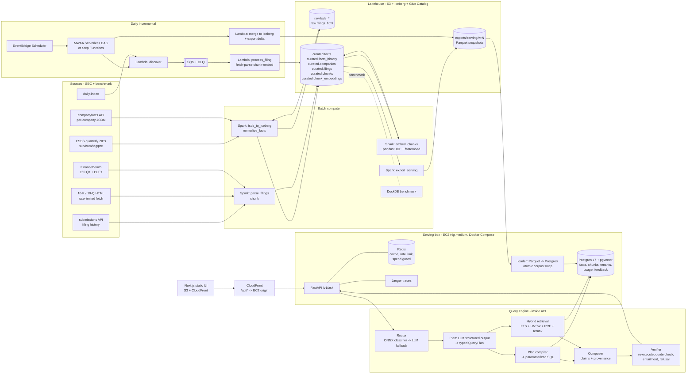

# 03: Architecture and technology stack

## 1. System at a glance



**Design decisions you must be able to defend** (each becomes an ADR in `docs/decisions.md`):

| ADR | Decision | One-line reason |
|---|---|---|
| 001 | Iceberg on S3 is the source of truth; Postgres is a rebuildable serving copy | Batch truth in the lake, low-latency reads in the serving store |
| 002 | Numbers come only from XBRL facts via a typed plan compiler; the LLM never writes SQL on the main path | Verifiable, safe and debuggable |
| 003 | Iceberg over plain Parquet | Atomic commits, MERGE for restatements, time travel for reproducible evals |
| 004 | No Kafka | Daily volume is a few hundred filings; SQS + a scheduler covers it. Project 2 shows streaming |
| 005 | One EC2 box for API + Postgres + Redis rather than Lambda + Aurora + ElastiCache | Lower cost, no cold starts, fits HNSW in RAM; scale path documented |
| 006 | No NAT gateway | Lambdas run outside the VPC; EC2 sits in a public subnet with no inbound ports except from CloudFront |
| 007 | DuckDB vs Spark: measured crossover | Honest big-data framing |
| 008 | Chunks of about 400 embedder tokens, never crossing section boundaries | Fits the 512-token embedder; citations stay meaningful |
| 009 | Hybrid lexical (Postgres FTS) + dense (HNSW halfvec) + RRF + cross-encoder rerank | Each component's recall is measured |
| 010 | Verifier separate from the composer; deterministic checks before the LLM entailment check | Cheap checks catch most errors; the LLM only judges entailment |
| 011 | Learned router with an LLM fallback (cascade) | Cost and latency at equal accuracy |
| 012 | Claude Haiku 5.5 for plan, router fallback and verifier; Sonnet 5.5 vs Haiku 5.5 composer chosen from the Pareto curve | Measured, not assumed |
| 013 | Daily orchestration on MWAA Serverless, with Step Functions as the fallback | Airflow's date-interval semantics give idempotent, catch-up-able daily runs, paid per task |
| 014 | Embedding model: bge-small-en-v1.5 (384-d) as halfvec | Memory: about 0.5–1 M vectors fit in a 4 GB box |
| 015 | Public demo protected by invite codes, per-key rate limit and a global daily spend cap | Abuse and credit drain |

## 2. Technology stack (pin versions in `pyproject.toml` / `package.json` during M0)

"Version" means the line to pin. Check for the latest patch release when you install.

| Layer | Technology | Version line | Why this one | Alternatives considered |
|---|---|---|---|---|
| Language | Python | 3.12 | Broadest wheel support for Spark, onnxruntime, fastembed | 3.13 (some wheels lag) |
| Env/deps | uv | latest | Fast, lockfile, reproducible | Poetry |
| Lint/format/types | ruff, mypy (strict on `app/engine`) | latest | One tool for lint and format | black + flake8 |
| Tests | pytest, Hypothesis, Testcontainers (Postgres), respx (HTTP mocks) | latest | Property tests for number normalization; real Postgres in tests | — |
| Batch engine | PySpark | **3.5.x** (match your EMR Serverless release) [Likely] | Same code locally and on EMR | Spark 4.x (only if your EMR/Glue target uses it) |
| JVM | OpenJDK | 17 | Spark 3.5 supports it [Likely] | 11 |
| Table format | Apache Iceberg (`iceberg-spark-runtime-3.5_2.12`) | match EMR bundled version | See ADR-003 | Delta Lake |
| Catalog | Local: Iceberg `hadoop` catalog in `./warehouse`; AWS: Glue Data Catalog | — | Zero local infra; Glue is free up to 1M objects/requests [Likely] | Iceberg REST + MinIO (dropped: setup time for no learning) |
| Python Iceberg | PyIceberg | latest | Lambda-side commits for the daily merge | Spark for everything |
| Benchmark engine | DuckDB | latest | ADR-007 | Polars |
| Ad-hoc lake SQL | Amazon Athena (engine v3) | — | Pay per TB scanned; workgroup scan limit | Trino |
| Cloud Spark | EMR Serverless (arm64) | EMR 7.x [Likely] | Per-second billing, auto-stop | AWS Glue jobs (the Free-plan path) |
| HTML parsing | selectolax (fast), lxml, BeautifulSoup for edge cases | latest | 10-K HTML is large; selectolax is much faster [Likely] | — |
| PDF parsing | PyMuPDF | latest | Page numbers are needed for FinanceBench evidence pages | pdfplumber |
| Tokenizer for chunking | Hugging Face `tokenizers` (the embedder's own) | latest | Chunk size measured in the embedder's tokens | tiktoken (wrong tokenizer) |
| Embeddings | fastembed (ONNX) with `BAAI/bge-small-en-v1.5` (384-d) | latest | CPU-friendly, same code on Mac, EMR, Lambda, EC2 → identical vectors | bge-base 768-d (better quality, 2× memory); nomic-embed (long context) |
| Reranker | Cross-encoder via fastembed (start with a MiniLM-L6 ms-marco model; try `bge-reranker-base`) | latest | CPU latency vs quality, measured | No reranker |
| Serving DB | PostgreSQL + pgvector | PG 17, pgvector **0.8.x** (0.8.2 latest seen) [Likely] | HNSW, `halfvec` (0.7+), iterative scans for filtered ANN (0.8+) [Certain] | Aurora PG (Free plan capped at 1 GiB storage) |
| Lexical search | Postgres FTS (`tsvector`, `ts_rank_cd`) | — | No extra service; call it "lexical," not BM25 | ParadeDB `pg_search` for true BM25 |
| Cache/limits | Redis 7 (or Valkey 8) | 7.x | Lua token bucket, spend counter, answer cache | DynamoDB |
| API | FastAPI + Pydantic v2 + uvicorn (gunicorn workers) | latest | Typed contracts, OpenAPI for free | — |
| LLM SDK | `anthropic` Python SDK | latest | Structured outputs (`output_config.format`), prompt caching, Message Batches [Certain] | — |
| LLM models | `claude-haiku-5-5`, `claude-sonnet-5-5` (judge: Sonnet 5.5 or Opus 5.5) | current | Prices in `04_aws_and_cost_plan.md` §5 | — |
| SQL guard (fallback) | sqlglot | latest | Parse the AST, allow-list tables, inject LIMIT | regex (unsafe) |
| Entity resolution | rapidfuzz + SEC `company_tickers.json` + alias table | latest | Fast fuzzy match for company names | LLM-only |
| ML | scikit-learn, (optional) PyTorch + transformers, skl2onnx / optimum, onnxruntime, MLflow | latest | M7 router: train → track → export → serve | — |
| Tracing | OpenTelemetry SDK + auto-instrumentation → Jaeger (all-in-one) | latest | Latency breakdown per span; token cost as span attributes | AWS X-Ray via ADOT |
| Load testing | k6 | latest | Scriptable, thresholds as code | Locust |
| UI | Next.js (App Router, `output: 'export'`) + TypeScript + Tailwind | current stable | Static export → S3/CloudFront, no server | Plain React + Vite |
| Orchestration (daily) | Airflow DAG (local `airflow standalone`) → MWAA Serverless (YAML, dag-factory format [Likely]) | Airflow 3.x [Likely] | Date-interval semantics, catch-up | Step Functions + EventBridge (fallback) |
| Queue | SQS standard + DLQ | — | Fan-out for per-filing work, retries | — |
| IaC | Terraform with S3 backend + native lockfile | ≥ 1.10 [Likely] | No DynamoDB lock table needed | CDK |
| CI/CD | GitHub Actions + OIDC to AWS | — | No long-lived keys | — |
| Containers | Docker (arm64 images for Graviton), ECR | — | t4g is ARM | — |
| Secrets | SSM Parameter Store (standard, SecureString) | — | Free for standard parameters [Likely] | Secrets Manager (paid per secret) |

## 3. Local vs cloud topology

| Component | Local (your Mac) | AWS |
|---|---|---|
| Spark | `pyspark` in the uv venv, `local[*]`, 8–10 GB driver memory | EMR Serverless application, arm64, auto-stop after 5 min idle, **max capacity cap** (e.g. 64 vCPU / 256 GB) |
| Iceberg catalog | `hadoop` catalog at `./warehouse` | Glue Data Catalog, warehouse `s3://<lake-bucket>/warehouse` |
| Postgres + pgvector | `pgvector/pgvector:pg17` in docker compose | The same image on EC2 t4g.medium, data on gp3 EBS |
| Redis | `redis:7` in compose | The same, on EC2 |
| API | `uvicorn --reload` | Container on EC2 (arm64 image from ECR) |
| Tracing | Jaeger container | Jaeger container on EC2, bound to localhost (view via SSM port-forward) |
| UI | `next dev` | Static files in S3, served by CloudFront |
| Daily ingestion | `airflow standalone` + local functions | EventBridge → MWAA Serverless/Step Functions → Lambda + SQS |
| Secrets | `.env` (gitignored), key named `EDGARQA_ANTHROPIC_API_KEY` | SSM Parameter Store, read by the container at start |

## 4. Repo layout (final)

```
edgar-verified-qa/
  CLAUDE.md                       # from repo_starter/
  .claude/                        # settings, hooks, rules, skills, agents (repo_starter/)
  pyproject.toml  uv.lock  Makefile  docker-compose.yml  .env.example
  infra/terraform/
    envs/dev/                     # main.tf wiring modules; backend.tf (S3 + use_lockfile)
    modules/{lake,emr,serving,cdn,ingest,budgets,github_oidc}/
  pipelines/
    common/                       # spark_session.py (local|emr), config.py, paths.py
    fetch/                        # sec_client.py (rate limiter), download_fsds.py, fetch_filings.py
    spark/                        # fsds_to_iceberg.py, normalize_facts.py, parse_filings.py, chunk.py,
                                  # embed_chunks.py, export_serving.py, dq_checks.py
    duckdb/                       # normalize_facts_duckdb.py (benchmark twin)
    parsing/                      # shared by Spark + Lambda: html_to_sections.py, tables.py, chunker.py, pdf.py
    airflow/dags/                 # filings_daily_incremental.py (+ .yaml for MWAA Serverless)
    lambdas/{discover,process_filing,merge,companyfacts}/
  serving/
    load/                         # load_snapshot.py (Parquet -> Postgres, atomic swap)
    sql/                          # 001_schema.sql, 002_indexes.sql, views
  app/
    api/                          # main.py, routes.py, auth.py, ratelimit.py, cache.py, spend_guard.py, telemetry.py
    engine/
      router/                     # YOU: classifier.py (ONNX), cascade.py
      plan/                       # YOU: schema.py (QueryPlan), metric_catalog.yaml, compiler.py, periods.py
      entities/                   # resolve_company.py, aliases.csv
      retrieval/                  # lexical.py, dense.py, fuse.py, rerank.py
      compose/                    # composer.py, prompts/
      verify/                     # YOU: numeric.py, quotes.py, entail.py, policy.py
      sql_guard/                  # YOU: guard.py (fallback text-to-SQL)
    llm/                          # client.py (model registry, retries, caching, token accounting), stub.py
  ml/router/                      # data.py, train.py, evaluate.py, export_onnx.py, mlruns/ (gitignored)
  web/                            # Next.js app
  eval/
    sets/                         # financebench.jsonl, numeric_auto.jsonl, narrative.jsonl, unanswerable.jsonl,
                                  # regressions.jsonl, router_test.jsonl
    gen/                          # make_numeric_set.py, make_unanswerable.py
    judges/                       # judge.py, calibration.jsonl (your hand labels)
    run.py                        # one entry point -> eval/results/<run_id>.json
    report.py                     # results.json -> docs/results.md tables (+ bootstrap CIs)
  load/                           # k6: numeric_path.js, cached_path.js, retrieval_stubbed.js
  tests/{unit,integration,property}/
  docs/
    plan/                         # copy of manual/milestones/*.md
    decisions.md  results.md  onboarding.md  runbook.md  architecture.png
    milestones/                   # M00-report.md ... written by /dod
```

## 5. Request lifecycle (what happens on `POST /v1/ask`)

1. **Edge:** CloudFront `/api/*` → EC2:80. The security group admits only the CloudFront origin-facing prefix list, and the API also checks a secret `X-Origin-Verify` header that CloudFront adds.
2. **Auth:** `Authorization: Bearer <key>` → SHA-256 → lookup in `api_keys` (cached in Redis for 60 s).
3. **Rate limit:** Redis Lua token bucket per key (for example 20 requests/hour, burst 5). Global **spend guard:** if today's LLM cost is at or above the cap, return 503 with a friendly message.
4. **Cache:** key = sha256(normalized question + tenant + corpus_version + engine_version). On a hit, return in under 100 ms.
5. **Router:** the ONNX classifier gives probabilities over {numeric, narrative, hybrid, out_of_scope}. If max p < τ, an LLM router (Haiku 5.5, structured output) decides.
6. **Plan:** Haiku 5.5 with structured output → `QueryPlan` (companies, periods, metrics from the catalog enum, operation, narrative topics, section hints). Entity resolution in code (rapidfuzz + aliases) fills in CIKs.
7. **Numeric branch:** the plan compiler turns metric + period + operation into parameterized SQL over `facts` and returns values with fact IDs and a provenance expression.
8. **Narrative branch:** lexical top-50 and dense top-50 (filtered by CIK/year with `hnsw.iterative_scan`) → RRF → rerank the top 30 → top 8 chunks.
9. **Composer:** Sonnet 5.5 or Haiku 5.5 with structured output → `Answer{claims[]}`. Each claim carries provenance (fact IDs + expression, or chunk ID + exact quote).
10. **Verifier:** deterministic checks first (re-execute expressions, metadata match, number-in-text parse, quote is a substring of the chunk), then the LLM entailment check for text claims (Haiku 5.5, parallel per claim). Unsupported claims are dropped; refuse if the remainder doesn't answer the plan.
11. **Response:** answer markdown + claims + citations + verification status + cost + latency + trace ID. Write a `usage_log` row and cache the response.
